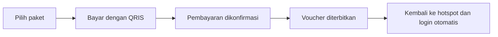

# MikBoX · MikroTik Hotspot Templates

**Dari halaman login, bayar QRIS, hingga terhubung ke internet.**

Koleksi template login hotspot MikroTik yang terintegrasi dengan **MikBoX Hotspot Manager**. Dirancang untuk memudahkan pelanggan memilih paket, membeli voucher, dan masuk ke jaringan melalui perangkat mereka sendiri.

[Pilih template](#pilihan-template) · [Cara pasang](#pemasangan) · [Integrasi MikBoX](#integrasi-mikbox) · [Lisensi MIT](LICENSE)

## Tentang MikBoX

MikBoX adalah aplikasi manajemen hotspot yang menghubungkan **pembayaran QRIS**, **otomatisasi pembelian dan pembuatan voucher**, serta **autentikasi pengguna**. Aplikasi manager berkomunikasi melalui API dengan MikroTik lokal maupun server RADIUS sesuai konfigurasi layanan.

Repository ini menyediakan bagian yang berhadapan langsung dengan pelanggan: halaman login, pemilihan paket, akses pembelian, dan informasi sesi hotspot.

| Komponen | Peran | Ketersediaan |
| --- | --- | --- |
| **Hotspot templates** | Antarmuka login, paket internet, tautan pembelian, dan status pengguna | Publik di repository ini · MIT |
| **MikBoX Hotspot Manager** | Mengelola layanan, paket, voucher, serta integrasi MikroTik lokal/RADIUS | Repository privat |
| **Payment gateway** | Memproses pembayaran QRIS dan meneruskan status pembayaran ke sistem | Repository privat |

Kode aplikasi manager dan payment gateway tidak disertakan dalam repository template ini. Fitur pembelian otomatis membutuhkan layanan MikBoX beserta integrasi pembayaran dan jaringan yang sudah dikonfigurasi.

## Alur pelanggan



Pelanggan membuka portal hotspot, memilih paket, lalu menyelesaikan pembayaran melalui MikBoX. Setelah pembayaran dikonfirmasi dan voucher tersedia, pelanggan diarahkan kembali ke halaman hotspot untuk login otomatis. Akses internet diberikan setelah autentikasi berhasil sesuai profil dan kebijakan jaringan.

## Pilihan template

| Template | Karakter tampilan | Panduan |
| --- | --- | --- |
| **[New-MikBoX](New-MikBoX/)** | Gaya modern dengan warna dasar pink lembut, pilihan palet, serta mode terang/gelap | [Pemasangan & konfigurasi](New-MikBoX/README.md) |
| **[Honai Grand Resort](Honai-Grand-Resort/)** | Gaya hotel/resort dengan slideshow foto, panel gradasi, aksen emas, dan empat pilihan warna | [Pemasangan & konfigurasi](Honai-Grand-Resort/README.md) |

Kedua varian menggunakan mesin integrasi hotspot yang sama. Pilih tampilan yang sesuai dengan identitas usaha, lalu sesuaikan melalui `config.js` di dalam folder template.

## Fitur utama

- **Login voucher dan member** — mode kode voucher atau username/password; mendukung CHAP dan fallback PAP sesuai pengaturan Hotspot.
- **Paket dari MikBoX** — nama paket, harga, waktu penggunaan, dan masa aktif ditampilkan dari layanan MikBoX tanpa menulis ulang daftar paket di template.
- **Pembelian melalui QRIS** — pelanggan melanjutkan ke halaman pembelian MikBoX dari paket yang dipilih.
- **Login otomatis setelah pembelian** — menerima kode voucher saat pelanggan kembali dari MikBoX dan mengirimkannya ke proses login hotspot.
- **Cek voucher dan status sesi** — akses pengecekan voucher melalui MikBoX, informasi kode/username, waktu, kuota, serta tombol salin dan logout sesuai data yang tersedia.
- **Trial, pengumuman, dan FAQ** — tombol coba gratis mengikuti izin trial pada router; informasi dan kontak dapat disesuaikan.
- **Aset lokal tanpa CDN** — HTML, CSS, JavaScript, dan ikon tersedia di folder template; tidak memerlukan proses build untuk dipasang.

## Pemasangan

1. **Pilih dan unduh template.** Unduh repository melalui **Code → Download ZIP**, kemudian ambil folder `New-MikBoX` atau `Honai-Grand-Resort`.
2. **Sesuaikan `config.js`.** Isi nama hotspot, identitas visual, informasi pelanggan, kontak, dan pengaturan MikBoX. Untuk varian resort, sesuaikan juga logo serta foto.
3. **Upload folder ke router.** Melalui **Winbox → Files**, unggah seluruh folder template beserta asetnya. Sebaiknya simpan salinan halaman hotspot sebelumnya.
4. **Pilih direktori halaman hotspot.** Buka **IP → Hotspot → Server Profiles**, pilih profil yang digunakan, lalu arahkan **HTML Directory** ke lokasi folder yang diunggah. Sesuaikan path dengan lokasi penyimpanan router.
5. **Aktifkan integrasi penjualan.** Ambil `idToko` dan aturan walled-garden dari **MikBoX → Router → Jual Online**, lalu terapkan sesuai konfigurasi layanan.
6. **Uji dari jaringan hotspot.** Periksa login voucher/member, katalog paket, akses pembelian sebelum login, proses kembali setelah pembayaran, dan halaman status.

Petunjuk khusus setiap varian tersedia pada README di folder masing-masing. Template dipasang pada **Hotspot MikroTik yang sudah aktif**; pengaturan router, koneksi RADIUS, dan layanan pembayaran dilakukan melalui sistem terkait.

## Integrasi MikBoX

Pengaturan koneksi berada di `config.js` pada template pilihan:

```javascript
mikbox: {
  alamat: "https://mikbox.mediakomputer.com",
  idToko: "ID_TOKO_ANDA",
},
```

Gunakan alamat layanan MikBoX yang Anda pakai dan `idToko` dari menu **Router → Jual Online**. Daftar paket dikelola di MikBoX, bukan di file HTML. Jika `idToko` kosong, bagian pembelian tidak ditampilkan. Jika permintaan katalog gagal, bagian pembelian tetap tersembunyi, sedangkan formulir login voucher tetap tersedia.

Agar alur pembelian berjalan sebelum pelanggan terautentikasi, akses ke layanan MikBoX dan halaman pembayaran yang dibutuhkan harus diizinkan oleh walled-garden. Gunakan aturan yang diberikan layanan untuk router Anda.

### Hal yang perlu diketahui

- **Voucher satu kode:** mode voucher menggunakan kode yang sama sebagai username dan password. Untuk akun dengan password berbeda, gunakan mode member.
- **Login otomatis:** halaman menerima parameter `mbx_voucher` dari alur kembali MikBoX. Voucher harus sudah valid pada MikroTik/RADIUS, dan perangkat masih harus dapat mengakses portal hotspot. Template tidak melewati proses autentikasi router.
- **Status sesi:** waktu penggunaan dan kuota mengikuti data RouterOS; informasi masa aktif tambahan membutuhkan respons layanan MikBoX.
- **Pratinjau browser:** membuka HTML langsung di komputer hanya untuk melihat tampilan. Variabel RouterOS seperti `$(link-login-only)` dan `$(username)` baru diproses saat halaman disajikan oleh Hotspot MikroTik.

## Kontribusi

Perbaikan tampilan, dokumentasi, dan varian template baru dapat diajukan melalui pull request. Untuk laporan kendala, sertakan nama template, versi RouterOS, perangkat/browser, dan langkah untuk mengulangi masalah. Hindari menyertakan password, kode voucher aktif, atau kredensial integrasi.

## Lisensi & pembuat

Template dalam repository ini tersedia di bawah **[MIT License](LICENSE)**: dapat digunakan dan dimodifikasi, termasuk untuk kebutuhan komersial, dengan tetap menyertakan pemberitahuan hak cipta dan lisensi. Lisensi ini berlaku untuk materi template yang tersedia di repository, bukan sebagai pemberian akses atau lisensi atas aplikasi manager maupun payment gateway privat.

Dikembangkan oleh **[Endy Ardhie](https://github.com/endyardhie)** untuk ekosistem **MikBoX**.
