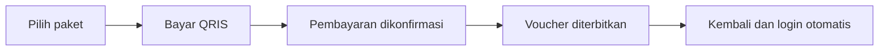

<h1 align="center">MikBoX · Hotspot Templates</h1>

<p align="center"><strong>Halaman login MikroTik untuk pengalaman hotspot yang lebih praktis.</strong></p>

<p align="center">Pilih paket · Bayar QRIS · Voucher otomatis · Login ke jaringan</p>

<p align="center">
  <a href="#pilihan-template">Pilih template</a> ·
  <a href="#pemasangan">Cara pasang</a> ·
  <a href="#integrasi-mikbox">Integrasi MikBoX</a> ·
  <a href="LICENSE">Lisensi MIT</a>
</p>

---

Repository ini adalah **pusat unduhan template login hotspot untuk pelanggan MikBoX**. Pilih tampilan yang sesuai dengan usaha Anda, sesuaikan identitasnya melalui `config.js`, lalu pasang pada router MikroTik.

## Pilihan template

| Template | Tampilan | Download & panduan |
| --- | --- | --- |
| **[New-MikBoX](New-MikBoX/)** | Modern, pink lembut, pilihan palet, serta mode terang/gelap | [Buka folder](New-MikBoX/) · [Panduan](New-MikBoX/README.md) |
| **[Honai Grand Resort](Honai-Grand-Resort/)** | Gaya hotel/resort, slideshow foto, panel gradasi, aksen emas, dan empat pilihan warna | [Buka folder](Honai-Grand-Resort/) · [Panduan](Honai-Grand-Resort/README.md) |

**[Download seluruh template (.zip)](https://github.com/endyardhie/MikBoX-Mikrotik-Template/archive/refs/heads/main.zip)** — setelah diekstrak, ambil folder template yang ingin digunakan.

## Terhubung dengan ekosistem MikBoX

**MikBoX Hotspot Manager** mengintegrasikan pembayaran QRIS, pembelian dan pembuatan voucher otomatis, serta autentikasi pengguna. Aplikasi manager berkomunikasi melalui API dengan MikroTik lokal maupun server RADIUS sesuai konfigurasi layanan.



Setelah pembayaran dikonfirmasi dan voucher tersedia, pelanggan diarahkan kembali ke portal hotspot. Template mengirimkan voucher untuk login; akses internet diberikan setelah autentikasi berhasil sesuai profil dan kebijakan jaringan.

| Komponen | Peran | Ketersediaan |
| --- | --- | --- |
| **Hotspot templates** | Login, daftar paket, akses pembelian, dan status sesi pelanggan | Publik di repository ini · MIT |
| **MikBoX Hotspot Manager** | Pengelolaan layanan, paket, voucher, dan integrasi MikroTik/RADIUS | Repository privat |
| **Payment gateway** | Pemrosesan QRIS dan penyampaian status pembayaran ke sistem | Repository privat |

Repository ini memuat template, sedangkan aplikasi manager dan payment gateway dikelola secara terpisah. Pembelian otomatis membutuhkan layanan MikBoX serta integrasi pembayaran dan jaringan yang sudah aktif.

## Fitur template

| Fitur | Kemampuan |
| --- | --- |
| **Login voucher & member** | Kode voucher atau username/password; CHAP dan fallback PAP mengikuti pengaturan Hotspot. |
| **Katalog paket dinamis** | Nama paket, harga, waktu penggunaan, dan masa aktif diambil dari MikBoX. |
| **Pembelian QRIS & login otomatis** | Pilih paket, lanjutkan pembayaran di MikBoX, lalu kembali ke hotspot dengan voucher. |
| **Voucher & status sesi** | Akses cek voucher, kode/username, waktu, kuota, salin kode, dan logout sesuai data yang tersedia. |
| **Identitas usaha** | Nama hotspot, logo, pengumuman, FAQ, dan kontak melalui `config.js`. |
| **Trial & aset lokal** | Trial mengikuti izin router; HTML, CSS, JavaScript, dan ikon tersedia tanpa CDN atau proses build. |

## Pemasangan

1. **Download dan pilih template.** Ekstrak ZIP, kemudian ambil folder `New-MikBoX` atau `Honai-Grand-Resort`.
2. **Edit `config.js`.** Sesuaikan identitas usaha, tampilan, kontak, serta alamat MikBoX dan `idToko`. Untuk varian resort, sesuaikan juga logo dan foto.
3. **Upload ke router.** Buka **Winbox → Files**, lalu unggah seluruh folder template beserta asetnya. Simpan salinan halaman hotspot sebelumnya.
4. **Pilih folder hotspot.** Buka **IP → Hotspot → Server Profiles**, pilih profil yang digunakan, lalu isi **HTML Directory** dengan path folder template sesuai lokasi penyimpanan router.
5. **Atur integrasi dan walled-garden.** Ikuti bagian [Integrasi MikBoX](#integrasi-mikbox) di bawah agar toko dapat diakses sebelum login.
6. **Uji dari jaringan hotspot.** Periksa login, daftar paket, akses toko, alur setelah pembayaran, dan halaman status.

Template digunakan pada **Hotspot MikroTik yang sudah aktif**. Petunjuk khusus tampilan dan file tersedia di README masing-masing template.

## Integrasi MikBoX

### 1. Hubungkan template ke layanan

Di `config.js`, isi bagian berikut:

```javascript
mikbox: {
  alamat: "[url-MikBoX]",
  idToko: "ID_TOKO_ANDA",
},
```

Ganti `[url-MikBoX]` dengan alamat lengkap layanan MikBoX Anda, termasuk `https://`. Isi `idToko` dari **MikBoX → Router → Jual Online**. Paket dan harga dikelola melalui MikBoX, sehingga tidak perlu ditulis ulang di template.

### 2. Izinkan toko dibuka sebelum login

**Paste/tempel pada Terminal MikroTik agar halaman toko MikBoX bisa dibuka sebelum login:**

```routeros
/ip hotspot walled-garden ip add action=accept dst-host=[url-MikBoX] comment="MikBoX"
```

**Ganti placeholder sebelum menjalankan perintah.** Pada `dst-host`, gunakan **hostname/domain saja**, tanpa `https://`, path, atau tanda kurung siku.

| Penggunaan | Contoh pengisian |
| --- | --- |
| `mikbox.alamat` di `config.js` | `https://mikbox.example.com` |
| `dst-host` di Terminal MikroTik | `mikbox.example.com` |

Jika layanan pembayaran membutuhkan domain tambahan, gunakan pula aturan dari **MikBoX → Router → Jual Online** sesuai konfigurasi layanan Anda.

<details>
<summary><strong>Catatan integrasi & pengecekan</strong></summary>

- **Bagian pembelian tidak tampil:** pastikan `alamat` dan `idToko` terisi, layanan dapat dijangkau sebelum login, serta katalog berisi paket. Jika `idToko` kosong atau permintaan katalog gagal, bagian pembelian tetap tersembunyi; formulir login voucher tetap tersedia.
- **Voucher satu kode:** mode voucher menggunakan kode yang sama sebagai username dan password. Gunakan mode member untuk akun dengan password berbeda.
- **Login otomatis:** template menerima parameter `mbx_voucher` dari alur kembali MikBoX. Voucher harus sudah valid pada MikroTik/RADIUS dan perangkat tetap dapat mengakses portal hotspot.
- **Status sesi:** waktu penggunaan dan kuota mengikuti data RouterOS; informasi masa aktif tambahan membutuhkan respons layanan MikBoX.
- **Pratinjau browser:** membuka HTML langsung di komputer hanya untuk melihat tampilan. Variabel seperti `$(link-login-only)` dan `$(username)` diproses saat halaman disajikan oleh Hotspot MikroTik.

</details>

## Lisensi

Template tersedia di bawah **[MIT License](LICENSE)**: dapat digunakan dan dimodifikasi, termasuk untuk kebutuhan komersial, dengan tetap menyertakan pemberitahuan hak cipta dan lisensi. Lisensi tersebut berlaku untuk materi template di repository ini; akses dan lisensi aplikasi manager maupun payment gateway privat diatur secara terpisah.
